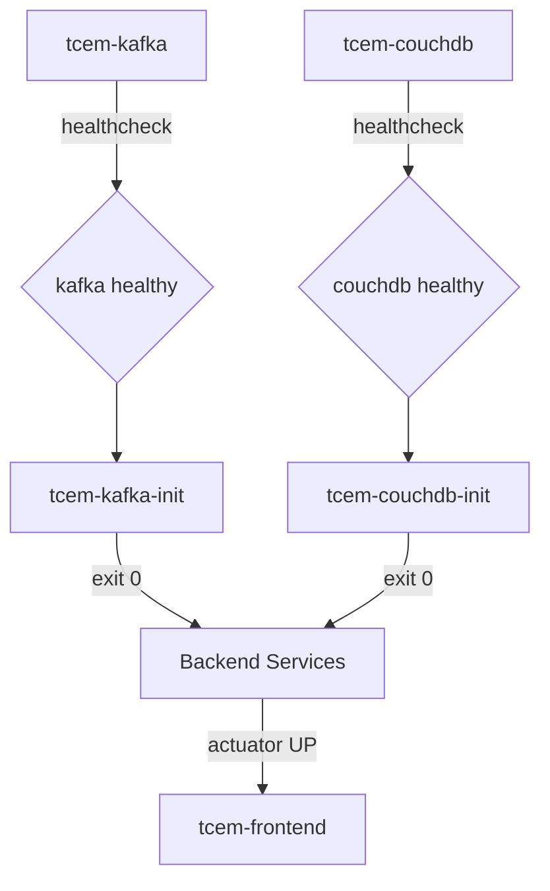

# DevOps, Containerization & Orchestration Guide

This document is the public reference for the containerization, local orchestration, and infrastructure provisioning architecture of the Trade Confirmation & Exception Management (TCEM) platform.

---

## 1. Overview & Evaluation Alignment

In accordance with the project specification and evaluation criteria (containerization quality, automated provisioning, non-root security, and horizontal scalability):
- **Zero-Manual-Setup Local Orchestration**: All dependencies (Kafka broker, Kafka UI, CouchDB database, topics, and collections) are self-bootstrapping via `docker compose up`.
- **Production-Grade Container Hardening**: Multi-stage builds, Alpine-based minimal runtimes, container-aware JVM ergonomics, and least-privilege non-root execution (`appuser:appgroup`).
- **Kafka Partitioning**: All 10 platform topics are pre-provisioned with **3 partitions** to enable consumer group scaling and test parallel event streams.
- **Strict Startup Dependency Graph**: Application services start only after database engines pass active health checks and initialization containers exit successfully (`code 0`).

---

## 2. Infrastructure Architecture & Service Inventory

All containers communicate over an isolated Docker bridge network (`tcem-network`), allowing internal DNS resolution (e.g., `kafka:19092`, `couchdb:5984`, `ingestion-service:8081`).

| Container / Service | Image Base | Internal Port | Host Port | Purpose |
|---|---|---|---|---|
| **`tcem-kafka`** | `apache/kafka:3.8.0` | `19092` / `19093` | `9092` | Event streaming broker in KRaft mode (single-node cluster). |
| **`tcem-kafka-init`** | `apache/kafka:3.8.0` | N/A | N/A | One-shot init container creating 10 Kafka topics with 3 partitions. |
| **`tcem-kafka-ui`** | `provectuslabs/kafka-ui:latest` | `8080` | `8080` | Web UI for inspecting topics, partitions, and consumer lag. |
| **`tcem-couchdb`** | `couchdb:3.3` | `5984` | `5984` | NoSQL document database for trades, audit logs, and exceptions. |
| **`tcem-couchdb-init`** | `curlimages/curl:8.6.0` | N/A | N/A | One-shot init container provisioning system and application DBs. |
| **`tcem-ingestion-service`** | `eclipse-temurin:21-jre-alpine` | `8081` | `8081` | Trade intake, schema validation, raw persistence (FR1–FR3). |
| **`tcem-enrichment-service`** | `eclipse-temurin:21-jre-alpine` | `8082` | `8082` | Reference data enrichment (FR4). |
| **`tcem-validation-service`** | `eclipse-temurin:21-jre-alpine` | `8083` | `8083` | STP rules engine and confirmation generation (FR5–FR6). |
| **`tcem-exception-service`** | `eclipse-temurin:21-jre-alpine` | `8084` | `8084` | Exception classification and recommendation (FR7–FR9). |
| **`tcem-workitem-service`** | `eclipse-temurin:21-jre-alpine` | `8085` | `8085` | Work item tracking, audit trail, DLQ & replay (FR10, FR12). |
| **`tcem-frontend`** | `nginx:1.27-alpine` | `80` | `3000` | Operations web dashboard (FR11). |

---

## 3. Automated Provisioning (Phases 1 & 2)

### A. Kafka Broker & `kafka-init`
Auto-creation of topics is explicitly disabled (`KAFKA_AUTO_CREATE_TOPICS_ENABLE: "false"`) to prevent accidental creation of single-partition topics. Instead, `kafka-init` executes idempotently once the broker passes its health check:

```bash
/opt/kafka/bin/kafka-topics.sh \
  --bootstrap-server kafka:19092 \
  --create --if-not-exists \
  --topic <topic-name> \
  --partitions 3 \
  --replication-factor 1
```

**Provisioned Topics (3 Partitions Each):**
1. `trade.raw`
2. `trade.accepted`
3. `trade.enriched`
4. `stp.validated`
5. `confirmation.generated`
6. `exception.created`
7. `exception.classified`
8. `workitem.linked`
9. `manual.review.required`
10. `deadletter.trade`

### B. CouchDB & `couchdb-init`
`couchdb-init` polls the CouchDB `/_up` endpoint and provisions required databases with HTTP PUT calls:
- **System Databases**: `_users`, `_replicator`, `_global_changes`
- **Application Databases**: `trades`, `confirmations`, `exceptions`, `work-items`, `audit-events`, `stp-metrics`, `dlq-entries`, `enrichment-idempotency`, `validation-idempotency`

### C. Health Checks & Readiness Dependency Graph
All services enforce strict readiness ordering:


- **Kafka Healthcheck**: Executes `/opt/kafka/bin/kafka-broker-api-versions.sh --bootstrap-server localhost:9092`.
- **CouchDB Healthcheck**: Executes `curl -f -s -u ${COUCHDB_USER}:${COUCHDB_PASSWORD} http://localhost:5984/_up`.
- **Backend Actuator Healthchecks**: Polls `http://localhost:<port>/actuator/health` via `wget`.

---

## 4. Production Dockerfile Hardening & Security (Phase 3)

All backend services implement standardized, hardened multi-stage Dockerfiles.

### Key Hardening Features:
1. **Multi-Stage Separation**:
   - **Build Stage**: Uses `maven:3.9.9-eclipse-temurin-21-alpine`. Includes BuildKit cache mounts (`--mount=type=cache,target=/root/.m2`) to speed up rebuilds.
   - **Runtime Stage**: Uses minimal `eclipse-temurin:21-jre-alpine`. The JDK, compilers, and Maven tools are completely omitted from production images.
2. **Non-Root Execution**:
   - Creates a dedicated system group and user: `RUN addgroup -S appgroup && adduser -S appuser -G appgroup`.
   - All runtime files are owned by `appuser:appgroup`.
   - Execution explicitly switched via `USER appuser`.
3. **Container-Aware JVM Ergonomics**:
   - `JAVA_OPTS="-XX:MaxRAMPercentage=75.0 -XX:+UseG1GC -Djava.security.egd=file:/dev/./urandom"`
   - Automatically adapts heap size to cgroup memory limits.
   - Uses non-blocking entropy source `/dev/./urandom` to eliminate container startup latency during crypto operations.
4. **Port Alignment**:
   - Each backend service exposes its designated unique port (`8081` through `8085`) rather than a default `8080`.
5. **Maven Reactor Discovery**:
   - The build stage copies the complete reactor tree (`COPY . .`) with `.dockerignore` filters, allowing Maven's reactor scanner to parse all child `<module>` definitions without error.

---

## 5. Developer Workflows & Commands

### Prerequisites
- Docker Engine 24+ & Docker Compose v2.x
- BuildKit plugin (`docker-buildx`) installed. On Arch/CachyOS: `sudo pacman -S docker-buildx`.
- User added to the `docker` group (`sudo usermod -aG docker $USER && newgrp docker`).

### Workflow A: Infrastructure Only (Recommended for Daily Backend Coding)
Spins up Kafka, CouchDB, Kafka UI, and runs the topic/database provisioning. Backend services are run directly from your IDE or CLI against `localhost`:

```bash
# 1. Start brokers, databases, and UI
docker compose up -d kafka couchdb kafka-ui

# 2. Run the one-shot initializers
docker compose up kafka-init couchdb-init
```

### Workflow B: Full Stack (Containerized Verification)
Spins up the complete platform including backend microservices:

```bash
docker compose up -d --build
```

### Workflow C: Helper Scripts (`scripts/`)
Alternatively, use the developer automation scripts in `scripts/`:
- **Start Stack**: `./scripts/dev-up.sh` (or `./scripts/dev-up.sh --infra-only`)
- **Run Smoke Test**: `./scripts/smoke-test.sh`
- **Seed Data**: `./scripts/seed-data.sh`
- **Stop Stack**: `./scripts/dev-down.sh` (or `./scripts/dev-down.sh --reset` to clear volumes)


### Stack Verification Commands

1. **Check Container Status**:
   ```bash
   docker compose ps
   ```
   All continuous services should be `Up (healthy)`, and init containers should be `Exited (0)`.

2. **Verify Kafka Topics**:
   ```bash
   docker exec tcem-kafka /opt/kafka/bin/kafka-topics.sh \
     --bootstrap-server localhost:9092 --list
   ```

3. **Verify Kafka Topic Partition Count**:
   ```bash
   docker exec tcem-kafka /opt/kafka/bin/kafka-topics.sh \
     --bootstrap-server localhost:9092 --describe --topic trade.raw
   ```
   Confirm `PartitionCount: 3`.

4. **Verify CouchDB Databases**:
   ```bash
   curl -s -u admin:password http://localhost:5984/_all_dbs
   ```

5. **Verify Backend Health & APIs**:
   ```bash
   curl -s http://localhost:8081/actuator/health
   curl -s http://localhost:8081/trades/scenarios
   ```

6. **Tear Down the Stack**:
   ```bash
   docker compose down       # Preserves CouchDB volume data
   docker compose down -v    # Resets CouchDB volume data to clean state
   ```
