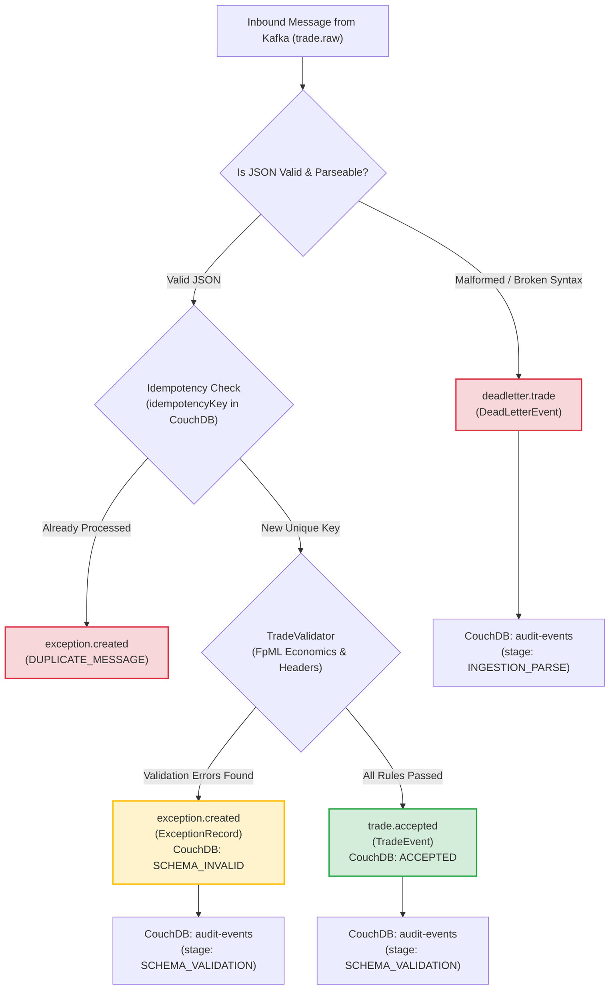

# Ingestion Service (`ingestion-service`)

> **Edge Intake Gateway, Schema Validation Engine & Audit Ledger for the Trade Confirmation & Exception Management (TCEM) Platform**  
> **Service Port:** `8081` · **Runtime:** Java 21 / Spring Boot 3.3 · **Storage:** Apache CouchDB 3.3 · **Streaming:** Apache Kafka 3.8

---

## Table of Contents
1. [Overview & Real-World Context](#1-overview--real-world-context)
2. [Architecture & Message Lifecycle](#2-architecture--message-lifecycle)
3. [Core Capabilities](#3-core-capabilities)
4. [Understanding the Data & Numbers](#4-understanding-the-data--numbers)
   - [Why Kafka retains messages (Kafka vs Queues)](#kafka-log-retention-vs-traditional-queues)
   - [The Math: 50 Raw Ingested Trades](#the-math-50-raw-ingested-trades)
   - [Why CouchDB has 98 Trade Docs and 50 Audit Docs](#why-couchdb-has-98-trade-docs-and-50-audit-docs)
5. [REST API Reference & Quick Examples](#5-rest-api-reference--quick-examples)
6. [Quickstart: Running & Testing Locally](#6-quickstart-running--testing-locally)
7. [Downstream Service Contracts](#7-downstream-service-contracts)
8. [Automated Testing & Test Doubles](#8-automated-testing--test-doubles)

---

## 1. Overview & Real-World Context

In Tier-1 Investment Banks (e.g., Goldman Sachs, JPMorgan, Barclays), millions of Over-The-Counter (OTC) Foreign Exchange (FX) trades are executed every day across electronic trading venues (Bloomberg, Tradeweb, Reuters, FIX protocol feeds).

### Why There Is No Manual Trade Entry UI
Traders and algorithms execute transactions in milliseconds. Post-trade confirmation systems **never use manual UI forms for initial trade entry**. Instead, trades arrive strictly as asynchronous message streams.

The **`ingestion-service`** acts as the **Border Control & Customs Office** of the entire platform:
1. It intakes raw FpML (Financial products Markup Language) JSON envelopes from Kafka topic `trade.raw`.
2. It enforces **idempotency** to guarantee that network retries or Kafka replays never duplicate financial risk.
3. It performs rigorous **schema validation** (mandatory fields, ISO codes, counterparty roles, option economics).
4. It persists raw payloads, canonical trade models, and immutable audit trails in **Apache CouchDB**.
5. It routes clean trades downstream for straight-through processing, invalid trades to exception remediation, and corrupted bytes to a dead-letter queue.

```
   [Execution Venues / Feeds]
               │
               ▼
   [Kafka Topic: trade.raw]
               │
               ▼
     ╔═══════════════════════════════════════════════════╗
     ║               ingestion-service                   ║
     ║  ┌─────────────────┐     ┌─────────────────────┐  ║
     ║  │  Idempotency    │ ──► │  Schema Validation  │  ║
     ║  │  Deduplication  │     │  Engine             │  ║
     ║  └─────────────────┘     └─────────────────────┘  ║
     ║            │                        │             ║
     ║            ▼                        ▼             ║
     ║  ┌─────────────────┐     ┌─────────────────────┐  ║
     ║  │ CouchDB Trades  │     │  CouchDB Audit Logs │  ║
     ║  └─────────────────┘     └─────────────────────┘  ║
     ╚═══════════════════════════════════════════════════╝
               │                   │                  │
         (Clean STP)       (Business Error)    (Malformed JSON)
               │                   │                  │
               ▼                   ▼                  ▼
       [trade.accepted]   [exception.created]  [deadletter.trade]
               │                   │                  │
               ▼                   ▼                  ▼
        Enrichment Svc       Exception Svc       Workitem DLQ
```

---

## 2. Architecture & Message Lifecycle

### The 3-Way Routing Engine

When a message arrives on `trade.raw`, the ingestion pipeline executes the following workflow:



---

## 3. Core Capabilities

| Capability | Description | Primary Classes |
|---|---|---|
| **Synthetic Trade & Scenario Generator** | Generates deterministic FX Option trades covering 10 business scenarios (valid vanilla options, barrier options, amendments, missing strike, invalid dates, unknown counterparty, malformed JSON). Loads 500 pre-packaged seed trades. | [`SyntheticTradeGenerator`](src/main/java/com/tcem/ingestion/generator/SyntheticTradeGenerator.java)<br>[`sample-trades.json`](src/main/resources/sample-trades.json)<br>[`TradeProducerController`](src/main/java/com/tcem/ingestion/controller/TradeProducerController.java) |
| **FpML Schema Validation Engine** | Validates message envelope headers, ISO-8601 timestamps, BUY/SELL side, CALL/PUT type, currency ISO codes, positive strike & notional values, and party roles (BANK + COUNTERPARTY). Converts failures into standard `ExceptionRecord` instances. | [`TradeValidator`](src/main/java/com/tcem/ingestion/validator/TradeValidator.java)<br>[`ValidationResult`](src/main/java/com/tcem/ingestion/validator/ValidationResult.java)<br>[`ValidationError`](src/main/java/com/tcem/ingestion/validator/ValidationError.java) |
| **Raw Inbound Persistence & Audit Trail** | Persists un-mutated raw inbound payloads alongside canonical trades in CouchDB `trades` database. Logs chronological, immutable lifecycle records to `audit-events` database with revisions (`_rev`) and Mango query indexes. | [`CouchDbClient`](src/main/java/com/tcem/ingestion/couchdb/CouchDbClient.java)<br>[`TradeCouchDbRepository`](src/main/java/com/tcem/ingestion/repository/TradeCouchDbRepository.java)<br>[`AuditCouchDbRepository`](src/main/java/com/tcem/ingestion/repository/AuditCouchDbRepository.java) |
| **Operations STP Metrics & Health Telemetry** | Real-time calculation of Straight-Through Processing (STP) rates and volume counters exposed via REST API and Actuator health checks for the React dashboard. | [`IngestionMetricsService`](src/main/java/com/tcem/ingestion/service/IngestionMetricsService.java)<br>[`TradeQueryController`](src/main/java/com/tcem/ingestion/controller/TradeQueryController.java)<br>[`CouchDbHealthIndicator`](src/main/java/com/tcem/ingestion/couchdb/CouchDbHealthIndicator.java) |
| **Dead-Letter Trapping & Edge Idempotency Filter** | Traps unparseable JSON into `deadletter.trade` with full error diagnostic metadata. Calculates composite idempotency keys (`idempotency:<tradeId>:<msgId>:<ver>:<eventType>`) to suppress duplicate message processing. | [`TradeRawConsumer`](src/main/java/com/tcem/ingestion/consumer/TradeRawConsumer.java)<br>[`IdempotencyCouchDbRepository`](src/main/java/com/tcem/ingestion/repository/IdempotencyCouchDbRepository.java)<br>[`DeadLetterProducer`](src/main/java/com/tcem/ingestion/producer/DeadLetterProducer.java) |

---

## 4. Understanding the Data & Numbers

When you publish a batch of **50 synthetic trades** into the system, here is how the numbers line up across Kafka, CouchDB, and the Metrics APIs:

### Kafka Log Retention vs. Traditional Queues

> **Common Question:** *"If `trade.raw` has 50 messages, shouldn't it go down to zero once the consumer reads them?"*

* **In RabbitMQ / SQS:** Messages are deleted as soon as they are acknowledged. Queue depth goes to `0`.
* **In Apache Kafka:** Topics are **immutable append-only commit logs**. Kafka **never deletes a message upon consumption**. Instead, it moves a bookmark pointer called the **Consumer Offset**.
* The 50 messages stay permanently on disk (until the retention period expires). Seeing **50 messages** in Kafka UI means all 50 messages were safely logged and stored!

### The Math: 50 Raw Ingested Trades

```
Total Inbound Raw Trades: 50
├── Parseable Trades Evaluated by Validator: 49
│   ├── Valid STP Trades  ──► Published to trade.accepted   : 39 (79.59% STP Rate)
│   └── Schema Invalid    ──► Published to exception.created : 10 (12 validation error records)
└── Malformed / Corrupted ──► Published to deadletter.trade  :  1 (Captured without crash)
```

$$\text{STP Rate} = \frac{\text{Accepted Trades}}{\text{Evaluated Trades}} = \frac{39}{49} = \mathbf{79.59\%}$$
$$\text{Overall Acceptance Rate} = \frac{\text{Accepted Trades}}{\text{Total Received}} = \frac{39}{50} = \mathbf{78.00\%}$$

### Why CouchDB has 98 Trade Docs and 50 Audit Docs

In CouchDB Fauxton (`http://localhost:5984/_utils`), you will observe:

#### 1. `audit-events` Database: Exactly 50 Documents
* **39 documents**: Audit entries for accepted trades (`stage: SCHEMA_VALIDATION`, `status: ACCEPTED`).
* **10 documents**: Audit entries for validation failures (`stage: SCHEMA_VALIDATION`, `status: SCHEMA_INVALID`).
* **1 document**: Audit entry for the malformed trade (`stage: INGESTION_PARSE`, `status: DEAD_LETTER`).
* **Total = 50 documents**. Every single raw message has an auditable record.

#### 2. `trades` Database: Exactly 98 Documents
* **49 Trade Documents**: Primary key `TRD-000001` through `TRD-000050` storing the canonical trade, economics, and raw payload (the 1 malformed trade had no trade ID to construct a trade entity).
* **49 Idempotency Marker Documents**: Primary key `idempotency:TRD-000001:MSG-000001:...` stored in CouchDB to ensure that if Kafka re-delivers the same message, it is detected and dropped immediately.
* **$49\text{ trades} + 49\text{ idempotency markers} = \mathbf{98\text{ documents}}$**.

---

## 5. REST API Reference & Quick Examples

The service runs on **port 8081** and provides CORS-enabled endpoints for the frontend and operations testing.

### Generation & Seeding

#### 1. Preview Synthetic Trades (Offline Dry-Run)
Generates trades in memory without sending them to Kafka:
```bash
curl -X POST "http://localhost:8081/trades/generate?count=5" | jq
```

#### 2. Publish Synthetic Trades to Kafka
Sends 50 realistic trades to `trade.raw` to test the live pipeline:
```bash
curl -X POST "http://localhost:8081/trades/generate?count=50&publishToKafka=true" | jq
```

#### 3. Seed Platform with 500 Pre-Packaged Trades
```bash
curl -X POST "http://localhost:8081/trades/seed?publishToKafka=true" | jq
```

#### 4. Trigger a Specific Edge Case Scenario
```bash
curl -X POST "http://localhost:8081/trades/generate/scenario?scenario=MISSING_ECONOMIC_STRIKE&publishToKafka=true" | jq
```

### Operations & Metrics

#### 5. Get Real-Time STP Rate
```bash
curl -s "http://localhost:8081/metrics/stp-rate" | jq
```
**Sample Response:**
```json
{
  "service": "ingestion-service",
  "stpRatePercent": 79.59,
  "totalTradesEvaluated": 49,
  "acceptedTrades": 39,
  "schemaInvalidTrades": 10,
  "timestamp": "2026-10-11T13:56:57.432Z"
}
```

#### 6. Get Metrics Counters Summary
```bash
curl -s "http://localhost:8081/trades/metrics/summary" | jq
```

#### 7. Paginated Trade Query with Status Filter
```bash
curl -s "http://localhost:8081/trades?status=ACCEPTED&page=0&size=5" | jq
```

#### 8. Single Trade with Complete CouchDB Audit Trail
```bash
curl -s "http://localhost:8081/trades/TRD-000001" | jq
```
**Sample Response Snippet:**
```json
{
  "trade": {
    "tradeId": "TRD-000001",
    "productType": "FX_OPTION",
    "processingStatus": "ACCEPTED",
    "canonicalTrade": {
      "fxOptionEconomics": {
        "underlier": "EUR/USD",
        "strike": 1.085,
        "notionalAmount": 1250000.0,
        "notionalCurrency": "USD",
        "optionType": "PUT",
        "buySell": "BUY"
      }
    }
  },
  "auditTrail": [
    {
      "stage": "SCHEMA_VALIDATION",
      "status": "ACCEPTED",
      "details": "Trade successfully validated and accepted",
      "timestamp": "2026-10-11T13:51:08.779Z"
    }
  ]
}
```

#### 9. Health & CouchDB Connectivity Check
```bash
curl -s "http://localhost:8081/actuator/health" | jq
```

---

## 6. Quickstart: Running & Testing Locally

### Prerequisites
* Docker & Docker Compose
* Java 21+
* Maven 3.9+

### 1. Start Infrastructure Containers
From the repository root:
```bash
docker compose up -d kafka kafka-ui couchdb
```
* **Kafka Broker:** `localhost:9092`
* **Kafka UI:** [http://localhost:8080](http://localhost:8080)
* **CouchDB Fauxton:** [http://localhost:5984/_utils](http://localhost:5984/_utils) *(admin / password)*

### 2. Start the Service
```bash
cd services/ingestion-service
mvn spring-boot:run
```

---

## 7. Downstream Service Contracts

| Downstream Service | Integration Channel | Contract / Payload | Operational Role |
|---|---|---|---|
| **Enrichment Service** (`:8082`) | Listens to **`trade.accepted`** | Clean `TradeEvent` (`capstone-fpml-json-1.0`) | Receives validated canonical trade, parties, and FX Option economics. Guaranteed free of schema errors or malformed syntax. |
| **Exception Service** (`:8084`) | Listens to **`exception.created`** | `ExceptionEvent` (`ExceptionRecord`) | Receives schema validation errors and duplicate message exceptions with correlation IDs and granular sub-theme codes. |
| **Workitem Service** (`:8085`) | Listens to **`deadletter.trade`** | `DeadLetterEvent` | Receives raw unparseable payloads, error diagnostic messages, and original transport headers for operational DLQ replay. |
| **Operations Frontend** (`:3000`) | REST APIs on Port **8081** | JSON Responses (`/metrics/stp-rate`, `/trades`) | Powers the real-time STP donut chart, trade search data table, and audit trail drill-down views. |

---

## 8. Automated Testing & Test Doubles

The service contains **99 comprehensive automated tests** that run in under 4 seconds in CI:

```bash
mvn -f services/ingestion-service/pom.xml test
```

```
[INFO] Tests run: 99, Failures: 0, Errors: 0, Skipped: 0
[INFO] BUILD SUCCESS
```

### Zero External Test Dependencies: `InMemoryCouchDbOperations`
To ensure lightning-fast CI builds and prevent flaky tests caused by local Docker state, an in-memory CouchDB double was built ([`InMemoryCouchDbOperations`](src/test/java/com/tcem/ingestion/couchdb/InMemoryCouchDbOperations.java)):
* Emulates CouchDB revision IDs (`_rev`), MVCC optimistic concurrency control, and Mango query filters (`_find`) entirely in RAM.
* Allows complete end-to-end integration tests ([`TradeIngestionPipelineIntegrationTest`](src/test/java/com/tcem/ingestion/integration/TradeIngestionPipelineIntegrationTest.java)) to verify consumer deduplication, validation routing, and CouchDB audit trails in milliseconds.
